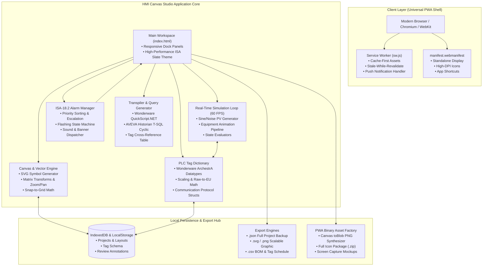

<div align="center">

# 🏭 HMI Canvas Studio
### Industrial SCADA Wireframing, ISA-101 HMI Design & FAT/SAT Quality Engineering PWA

[](https://web.dev/progressive-web-apps/)
[](https://www.isa.org/)
[](https://www.isa.org/)
[](https://www.aveva.com/)
[](LICENSE)

<br/>

```
  ┌────────────────────────────────────────────────────────────────────────┐
  │  ██╗  ██╗███╗   ███╗██╗     ██████╗ █████╗ ███╗   ██╗██╗   ██╗ █████╗  │
  │  ██║  ██║████╗ ████║██║    ██╔════╝██╔══██╗████╗  ██║██║   ██║██╔══██╗ │
  │  ███████║██╔████╔██║██║    ██║     ███████║██╔██╗ ██║██║   ██║███████║ │
  │  ██╔══██║██║╚██╔╝██║██║    ██║     ██╔══██║██║╚██╗██║╚██╗ ██╔╝██╔══██║ │
  │  ██║  ██║██║ ╚═╝ ██║██║    ╚██████╗██║  ██║██║ ╚████║ ╚████╔╝ ██║  ██║ │
  │  ╚═╝  ╚═╝╚═╝     ╚═╝╚═╝     ╚═════╝╚═╝  ╚═╝╚═╝  ╚═══╝  ╚═══╝  ╚═╝  ╚═╝ │
  │                    S  T  U  D  I  O      P  W  A                       │
  └────────────────────────────────────────────────────────────────────────┘
```

**Next-Generation Progressive Web App for SCADA Engineers, System Integrators & Commissioning Teams**  
*Optimized for Wonderware InTouch, ArchestrA Graphic Symbols, Multi-Protocol PLC Tag Maps, and FAT/SAT Project Delivery.*

[Explore Features](#-core-features) • [System Architecture](#-system-architecture) • [Directory Layout](#-universal-pwa-folder-structure) • [Installation](#-installation--deployment) • [Engineering Workflows](#-scada-engineering-workflows)

</div>

---

## 🧭 Executive Overview

**HMI Canvas Studio** is an offline-capable, cross-platform Progressive Web Application engineered specifically for automation professionals, SCADA engineers, and system integrators. Tailored for enterprise project delivery—such as industrial control networks, municipal water distribution, oil & gas process stations, and district cooling systems—it bridges the gap between early client wireframing, Wonderware ArchestrA symbol authoring, and rigorous Factory Acceptance Testing (FAT).

Designed to fulfill the responsibilities of a senior **SCADA Engineer** (adhering to corporate HSE and quality procedures such as `Annexure-SCT-HR-001`), this application executes fully in the browser with **zero cloud dependencies**, using IndexedDB and Service Workers for mission-critical offline reliability in remote sub-stations and industrial control rooms.

---

## ⚡ Core Features

```
┌───────────────────────────────────────────────────────────────────────────────┐
│                                FEATURE MATRIX                                 │
├─────────────────────────┬──────────────────────────┬──────────────────────────┤
│ 📐 ISA-101 Canvas       │ 🚨 ISA-18.2 Alarms       │ 📈 Multi-Pen Trending    │
│ • Dark/Gray HMI layout  │ • 4-tier color alerts    │ • Real-time telemetry    │
│ • Snap-to-grid vector   │ • ACK / Shelve / Suppress│ • Historian cyclic span  │
│ • Dynamic equipment SVG │ • Flash unack annunciator│ • Export CSV / waveforms │
├─────────────────────────┼──────────────────────────┼──────────────────────────┤
│ 🏷️ Tag & Protocol Map   │ 💻 QuickScript & SQL     │ 📋 QA, FAT & Estimations │
│ • OPC UA / Modbus / S7  │ • InTouch script syntaxes│ • Review pin annotations │
│ • Eng units & EU scaling│ • T-SQL Historian cyclic │ • Automated BOM exporter │
│ • Real, Discrete, Trend │ • Copy-paste ArchestrA   │ • QHSE compliance audit  │
└─────────────────────────┴──────────────────────────┴──────────────────────────┘
```

### 1. Vector HMI Graphic Studio (ISA-101 Standard)
- **High-Performance Process Display:** Low-contrast industrial slate background (`#0f172a`, `#1e293b`) that highlights abnormal operational events without cognitive fatigue.
- **Parametric Equipment Library:** Dynamic pumps, motorized control valves (MOV/FCV), variable-level process vessels, heat exchangers, agitators, piping manifolds, and analog gauges.
- **Dual Engine Modes:**
  - `DESIGN MODE`: Coordinate grid snapping, element scaling, z-index layering, and tag binding.
  - `RUN / SIMULATION MODE`: Real-time SVG process animation (rotating impellers, flowing pipe gradients, fluid level fluctuations, and live digital readouts).

### 2. Multi-Protocol PLC Tag Directory
- **Wonderware Native Type Support:** `Memory Discrete`, `Memory Real`, `I/O Real`, `I/O Integer`, `Indirect`, and `Historical Trend`.
- **Field Bus Mapping:** Direct association with field communication protocols:
  - **OPC UA / DA** (Kepware, ArchestrA DAServer, OI Server)
  - **Modbus TCP/IP** (Holding registers `40001+`, Input coils `00001+`)
  - **Siemens S7 Profinet / Industrial Ethernet** (`DBx.DBDx`, `M-Markers`)
  - **SuiteLink & BACnet IP**
- **Threshold Alarming:** Low-Low, Low, High, and High-High trip levels with engineering unit conversion ($bar$, $^\circ C$, $m^3/h$, $RPM$, $kW$).

### 3. ISA-18.2 Alarm Annunciation Banner
- **Dockable Plant Alarm Bar:** Mimics top-tier distributed control system (DCS) alarms with deterministic priority coloring:
  - 🟥 **Priority 1 (Critical):** Immediate process trip hazard (Fast $2\text{ Hz}$ red flash).
  - 🟧 **Priority 2 (High):** Equipment operating beyond normal envelope.
  - 🟨 **Priority 3 (Medium):** Process warning or deviating setpoint.
  - 🟦 **Priority 4 (Low / Diagnostic):** Communication link failure or advisory.
- **Full Alarm Lifecycle:** Unacknowledged $\rightarrow$ Acknowledged $\rightarrow$ Normalized $\rightarrow$ Shelved.

### 4. Code & Historian Query Generator
- **Wonderware QuickScript.NET:** Real-time generation of `On Show`, `While Showing`, `Condition`, and `Pushbutton Action` scripts based on bound canvas tags.
- **Industrial Historian T-SQL:** Generates performance-tuned cyclic queries for Wonderware/AVEVA Historian:
  ```sql
  SELECT DateTime, TagName, Value, Quality, QualityDetail
  FROM Runtime.dbo.History
  WHERE TagName IN ('PUMP_101_SPEED', 'TANK_LEVEL_PV')
    AND DateTime >= DATEADD(hh, -4, GETDATE())
    AND wwRetrievalMode = 'Cyclic'
    AND wwCycleCount = 1000;
  ```

### 5. Collaborative FAT/SAT QA & BOM Engine
- **Pinpoint Canvas Annotations:** Place collaborative review pins with status tags (`Draft`, `Client Clarification`, `Approved for FAT`).
- **QA Checklist:** Step-by-step verification matching corporate quality requirements and **Annexure-SCT-HR-001** (redundancy switchover, scale validation, loop checks, and emergency trip responses).
- **Automated BOM Costing:** Exports hardware/software Bill of Materials with I/O point counts, PLC license sizing, and field instrument lists directly to CSV for estimation teams.

---

## 🏛️ System Architecture



---

## 📁 Universal PWA Folder Structure

The project strictly follows the Universal PWA specifications with complete asset, styling, and offline provisioning:

```
hmi-canvas-studio/
├── .well-known/
│   └── assetlinks.json            # TWA (Trusted Web Activity) for Google Play Store
├── css/
│   └── styles.css                 # Industrial dark theme (ISA-101 gray scale)
├── icons/
│   ├── icon-72.png                # Legacy Android
│   ├── icon-96.png                # Standard Android
│   ├── icon-128.png               # Chrome Web Store
│   ├── icon-144.png               # Windows Taskbar
│   ├── icon-152.png               # Apple iPad Home
│   ├── icon-180.png               # Apple iPhone Touch Icon
│   ├── icon-192.png               # PWA Requirement Standard
│   ├── icon-384.png               # High-DPI Splash
│   ├── icon-512.png               # PWA Requirement Splash & Install
│   ├── icon-maskable-192.png      # Android Adaptive Icon (Maskable)
│   ├── icon-maskable-512.png      # Android Adaptive Icon Large
│   ├── favicon-16x16.png          # Classic Browser Tab
│   └── favicon-32x32.png          # Standard Desktop Tab
├── js/
│   ├── app.js                     # Core application engine, UI state & simulations
│   └── pwa-assets.js              # Programmatic HTML5 Canvas PNG & Icon Factory
├── screenshots/
│   ├── screenshot-mobile.png      # Narrow Form Factor Install Screenshot
│   └── screenshot-wide.png        # Desktop/Tablet Wide Install Screenshot
├── apple-touch-icon.png           # iOS Safari Web Clip Icon (180x180)
├── favicon.ico                    # Fallback Legacy Icon
├── favicon.svg                    # Scalable Industrial SCADA Node Vector Icon
├── index.html                     # Main application entry point & docking workspace
├── manifest.webmanifest           # W3C Web App Manifest
├── offline.html                   # Offline fallback presentation
├── robots.txt                     # Crawler and indexer control
├── sw.js                          # Production-ready Service Worker (Cache versioning)
└── README.md                      # Comprehensive Technical Documentation
```

---

## 🛠️ Technology Stack & Standards Compliance

| Domain | Standards / Technology | Implementation Detail |
|---|---|---|
| **PWA Spec** | Service Worker Cache API, Web Manifest v3 | Instant installation on Windows, macOS, Linux, iPadOS, Android |
| **HMI Standards** | ANSI/ISA-101.01-2015 | Ergonomic situational awareness, muted background palettes |
| **Alarm Standard**| ANSI/ISA-18.2-2016 | Standardized 4-tier alarm urgency, states, and acknowledgement |
| **SCADA Platforms**| Wonderware InTouch / AVEVA System Platform | ArchestrA symbol metaphors, QuickScript syntax, Galaxy dictionary |
| **Industrial Protocols**| OPC UA, Modbus TCP/IP, Siemens S7, BACnet | Addressing syntax verification, data type constraints, cycle times |
| **Quality & Safety**| ISO 9001, OHSAS 18001 / ISO 45001 | Annexure-SCT-HR-001 audit protocols, FAT/SAT sign-off stages |
| **Graphics Engine**| Native SVG & HTML5 Canvas | Zero-dependency high-DPI rendering up to 4K resolutions |

---

## 🚀 Installation & Deployment

### Method 1: Local Static Server (Fastest)

Because **HMI Canvas Studio** requires zero build steps, you can execute it with any static HTTP server:

```bash
# Clone the repository
git clone https://github.com/your-org/hmi-canvas-studio.git
cd hmi-canvas-studio

# Option A: Run via Node.js http-server
npx http-server -p 8080 -c-1

# Option B: Run via Python 3
python3 -m http.server 8080
```

Navigate to `http://localhost:8080` in Chrome, Edge, or Safari.

### Method 2: Enterprise Nginx Industrial Edge Deployment

Deploy directly onto industrial edge gateways (e.g., Moxa, Advantech, Siemens IPC) inside plant sub-networks:

```nginx
server {
    listen 443 ssl http2;
    server_name hmi-studio.internal.algurg.ae;

    ssl_certificate /etc/ssl/certs/scada-pwa.crt;
    ssl_certificate_key /etc/ssl/private/scada-pwa.key;

    root /var/www/hmi-canvas-studio;
    index index.html;

    # Service Worker must not be aggressively cached by the browser
    location = /sw.js {
        add_header Cache-Control "no-cache, no-store, must-revalidate";
        add_header Service-Worker-Allowed "/";
    }

    # Manifest and static asset caching
    location ~* \.(webmanifest|ico|svg|png|css|js)$ {
        expires 7d;
        add_header Cache-Control "public, max-age=604800, immutable";
    }

    location / {
        try_files $uri $uri/ /offline.html;
    }
}
```

---

## 🎮 SCADA Engineering Workflows

### 1. Canvas Wireframing & Equipment Placement
```
[Select Equipment Symbol] ─► [Click or Drag onto Canvas] ─► [Snap to 20px Grid]
                                                                  │
[Inspect Properties] ◄────── [Define Rotation & Dimensions] ◄────┘
        │
        ▼
[Bind Wonderware Tag (e.g. FIT_201_PV)]
```

### 2. Live Run-Time Simulation & Alarm Auditing
1. Toggle the toolbar switch from **`DESIGN`** to **`RUN SIMULATION`**.
2. Process variables will start fluctuating dynamically.
3. Click the **"Trigger High Process Trip"** button in the Alarm Testing toolbox.
4. Observe the **ISA-18.2 Alarm Annunciator**:
   - The graphic indicator turns flashing red.
   - The top banner flashes priority 1 information.
   - Click **`ACK`** to simulate an operator acknowledging the alarm (flashing stops, steady red remains).
   - Normalize the process variable to clear the alarm state.

### 3. FAT Sign-Off & Estimation Package Export
1. Open the **QA & Review Modal**.
2. Complete the Factory Acceptance Test verification checklist.
3. Add client notes regarding site survey measurements or control panel constraints.
4. Click **`Export BOM & Schedule`** to generate an automated CSV detailing:
   - All I/O Points and Tag Names
   - Assigned Field Protocols (Modbus / OPC UA)
   - Screen Resolution and Licensing tier recommendations

---

## 📦 PWA Icon & Asset Generation Engine

The application includes an integrated **PWA Asset Synthesizer** (`js/pwa-assets.js`). If binary PNG icons are missing during initial deployment, the studio dynamically renders high-resolution industrial graphics on an off-screen HTML5 Canvas and serves them as in-memory data URIs.

Clicking **"Download Complete Asset Bundle"** from the bottom toolbar renders and packages all 13 standard icon sizes, maskable icons, and mock installation screenshots ready to be committed directly to source control.

---

## 🔒 Security & Data Integrity

- **Isolated Local Storage:** Project files, tag tables, and system schematics never leave the host browser unless explicitly exported by the engineer.
- **Content Security Policy (CSP) Ready:** Contains no external CDN links or unhashed inline scripts, ensuring compatibility with strict air-gapped industrial demilitarized zones (IDMZ / ISA-99 / IEC 62443).

---

## 📄 License & Compliance Notice

Distributed under the **MIT License**.

> **Corporate & Quality Notice:** Developed for use under the engineering processes and quality frameworks of ** Automation and Controls (Dubai, U.A.E.)**. Ensure all finalized HMI designs comply with project-specific Functional Design Specifications (FDS), site-specific QHSE procedures, and **Annexure-SCT-HR-001**.
